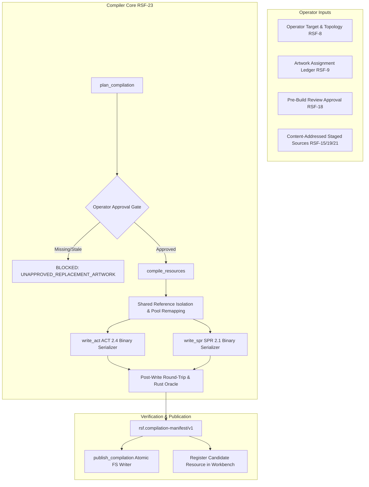

# RO Sprite Forge — RSF-23 Deterministic ACT/SPR Compiler & Metadata-Preserving Replacements

## 1. Architectural Role and Scope

RSF-23 implements the **deterministic binary asset compiler** and **metadata-preserving replacement engine** for RO Sprite Forge Milestone 5 (`M5: Deterministic Sprite Compilation and Native Verification`).

Its primary responsibility is translating operator-approved visual composition revisions into valid, deterministic, native-compatible **ACT 2.4** and **SPR 2.1** binary files, while preserving all unreplaced classic resource data, attached head resources, opaque header fields, delays, events, and multilayer anchoring metadata without flattening or silent quality degradation.

---

## 2. Binary Format Specifications & Serialization Invariants

### 2.1 SPR 2.1 Format & Lossless Serialization
- **Magic and Version:** `SP\x01\x02` (version 2.1, little-endian `0x0201`).
- **Indexed Image Pool (Pool 0):**
  - Header: `uint16_t width`, `uint16_t height`, `uint16_t rle_len`.
  - Zero-run RLE encoding: When byte is `0x00`, the following byte is the run count `N` (1 to 255) of transparent palette index 0 pixels. When byte is non-zero, it represents a single palette index byte.
  - Byte-exact RLE preservation: Unmodified indexed images preserve their exact input `raw_rle` bytes. Newly encoded indexed images use minimal zero-run encoding.
- **Truecolor RGBA Image Pool (Pool 1):**
  - Header: `uint16_t width`, `uint16_t height`.
  - Raw pixel data: Exactly `width * height * 4` bytes in `[R, G, B, A]` order.
  - Explicit RGBA replacement policy: When replacement art contains truecolor or semi-transparent content, it is placed into Pool 1 without silently quantizing or degrading color depth.
- **Palette:** Exactly 1024 bytes (256 RGBA/BGRA entries) appended at the end of the file. Unchanged palettes are byte-for-byte preserved.

### 2.2 ACT 2.4 Format & Structural Serialization
- **Magic and Version:** `AC\x04\x02` (version 2.4, little-endian `0x0204`).
- **Reserved Header:** Exactly 10 bytes (`uint16_t action_count`, `uint8_t reserved[10]`). All opaque reserved bytes are preserved.
- **Actions and Motions:**
  - 8 views per action slot for directional actions.
  - Per-motion bounding box: Exactly 8 signed 32-bit integers (`int32_t bounds[8]`), followed by `uint32_t clip_count`.
- **Clips / Layers:**
  - `int32_t x`, `int32_t y`: Signed layer displacement from actor origin.
  - `int32_t sprite_index`: 0-based image pool index.
  - `uint32_t mirror_flag`: 0 = normal, 1 = horizontal flip.
  - `uint32_t color`: 4-byte RGBA DWORD (`0xFFFFFFFF` default opaque white tint).
  - `float32_t scale_x`, `float32_t scale_y`: Clip scaling factors.
  - `int32_t angle`: Clockwise rotation in degrees.
  - `uint32_t image_type`: Image pool selector (0 = Indexed, 1 = Truecolor RGBA).
- **Events and Delays:**
  - Global event sound triggers and per-action delay multipliers (float32) are preserved without loss.
- **Anchors:**
  - Per-frame attachment anchors (used by player head attachments) are preserved exactly.

---

## 3. Bounded Replacement Semantics & Integrity Gates

### 3.1 Bounded Replacement vs Full Production Export
- **Bounded Replacement (`compilation_mode="bounded_replacement"`):**
  - Replaces only the specific actions, views, and frames declared by the operator and approved in the review ledger (e.g. Walk view 0).
  - Unreplaced classic numeric action slots (Idle, Attack, Hit, Die, etc.) and frames remain byte-for-byte or semantically identical to the reference resource.
  - Classic retained art is explicitly flagged outside new-art completeness in the manifest (`preservation_summary.classic_retained_outside_completeness = true`).
  - Output manifest marks `status.export_ready = false` and `status.production_authorized = false`.
- **Production Export (`compilation_mode="production_export"`):**
  - Requires 100% complete artwork assignments and operator visual approval across all declared requirements.

### 3.2 Multilayer Topology & Non-Flattening Guarantee
- Distinct visual layers within a frame (e.g., body, clothing, equipment) are compiled as distinct, ordered ACT clips.
- Layers are **never collapsed or pixel-flattened** into a single image.
- Layer order, clip transforms, offsets, tint colors, and alphas are independently preserved in the compiled ACT binary.

### 3.3 Separate Head Resource Invariant
- In player characters (e.g., Male Novice), head resources (`head.act` and `head.spr`) are separate assets anchored to the body via ACT anchor points.
- The compiler strictly maintains the boundary between body and head:
  - Compiling a modified body preserves all head attachment anchors and outputs separate, unchanged head resources (`preservation_summary.head_resources_preserved_unchanged = true`).
  - Head sprites are never merged or flattened into the body sprite pool.

### 3.4 Reference Isolation & Pool Remapping (`COPY_ON_WRITE_APPEND`)
- Classic Ragnarok sprites frequently reuse the same SPR image across multiple ACT frames and action slots.
- Modifying a targeted clip must not silently alter non-targeted clips sharing the same sprite index.
- The compiler implements **Copy-on-Write Reference Isolation**:
  - Unaffected clips continue referencing the original image index.
  - The replacement image is appended to the SPR pool.
  - Only the targeted clip's `sprite_index` and `image_type` are remapped to the new pool entry.

---

## 4. Single-Execution of Transformations

Transformations staged via RSF-21 are imported into the content-addressed blob store as concrete, validated PNG artifacts.
When compiled:
- The compiler directly consumes the staged PNG pixels.
- Staged recipes are not reapplied or double-executed (`reapplied_in_compiler: false`).
- Ledger-level mirror operations (if specified directly on the assignment) are executed deterministically during compilation.

---

## 5. Verification Architecture & Truthful Gates

Every compilation artifact is subjected to automated verification before publication:
1. **Decode-After-Write (`verification.decode_after_write`):**
   - The generated binary bytes are immediately fed back into `read_act()` and `read_spr()`.
   - Structural counts, image dimensions, and clip parameters are verified against input specifications.
2. **Independent Rust Oracle (`verification.rust_oracle`):**
   - The compiled files are verified against the independent Rust decoder (`rsf-rust-oracle`) to ensure third-party parser compatibility and absence of corruption.
3. **No-Op Preservation Check (`verification.noop_byte_equal`):**
   - Compiling with zero replacements against an unchanged resource produces byte-for-byte identical output.
4. **Native Korangar Gate (`verification.native_korangar`):**
   - RSF-23 provides the binary compilation foundation. Native runtime execution proof belongs to RSF-24.
   - The manifest explicitly records `native_korangar: "UNVERIFIED"`, strictly preventing premature claims of native playback.

---

## 6. Manifest and Data Contracts

Compilation results are certified with canonical, sealable manifests conforming to Draft 2020-12 schema `src/ro_sprite_forge/schemas/compilation-manifest-v1.json`:
- Schema identifier: `rsf.compilation-manifest/v1`
- Input and output resource SHA-256 digests and byte lengths
- Comprehensive preservation summary (modified vs untouched slots, frames, clips)
- Detailed per-replacement ledger (target requirement, original vs output image, source origin, review state)
- Explicit orthogonal verification statuses (`decode_after_write`, `rust_oracle`, `native_korangar: "UNVERIFIED"`)
